# 👋 Hey, I'm Jhay Landrei Marcelino!

### Full-Stack Software Developer | Mobile • Web • Backend • Intelligent Systems

I'm a Computer Science graduate majoring in Intelligent Systems and a Full-Stack Software Developer passionate about building practical, secure, and user-focused software solutions.

I enjoy exploring different technologies, solving real-world problems, and continuously improving my skills as a software engineer.

---

### 🚀 About Me

- 🎓 Computer Science Graduate
- 💼 Full-Stack Software Developer
- 🤝 Freelance Developer since 2021
- 🏢 Former IBM Intern — Project Manager & Team Leader
- 🧠 Interested in Software Development, Intelligent Systems, Machine Learning, and Application Security
- 🔐 Experienced in authentication, encryption, hashing, and RBAC
- 🌱 Continuously learning and building better software.

---

### 🛠️ Languages and Technologies

**Programming Languages**

  

**Frameworks and Development**

  

**Databases and Tools**

  

**Cloud and Payments**

  

  
  
  
  

**Machine Learning**

  

---

### 💻 Featured Projects

| Project | Description |
|---|---|
| **Dish Is It** | AI-powered recipe suggestion application utilizing Natural Language Processing. |
| **SNED-LINK+** | Educational platform supporting special needs education workflows. |
| **Medicinal Plant Classification** | Deep learning-based image classification and recognition system for medicinal plants. |
| **Steno Salin** | Stenography interpreter designed for the Filipino language (Tagalog). |
| **Taekwondo Bracketing System** | Competition bracketing and tournament management system. |
| **Water Billing System** | Water billing and management application. |
| **STI Tour** | Interactive tour-related application. |
| **Fitness Tracker** | Application for tracking fitness-related activities. |

---

### 📊 GitHub Statistics

  
  

---

### 🔥 Contribution Streak

  

---

### 📈 Contribution Activity

<!-- BEGIN ACTIVITY-GRAPH -->
<picture>
  <source media="(max-width: 767px)" srcset="activity-graph-mobile.svg">
  
</picture>
<!-- END ACTIVITY-GRAPH -->

---

### 🏆 Achievements and Recognition

- 🥉 **3rd Place, Best in Research** — Research Congress 2025.
- 🥉 **Top 3, Undergraduate Thesis** — National Research Conference on Information Technology Education (NRCITE), Integrated Society of Information Technology Enthusiasts (iSITE Inc.) 2025.
- 🏅 **Top 3 Best Project** — IBM 2025.
- 🎖️ **Service Awardee** — Laguna State Polytechnic University 2025.
- 🏅 **Top 6** — iSITE National Programming Competition 2023.
- 🏆 **Champion** — Programming Competition, LSPU 2022.

---

### 🐍 Contribution Snake

  <picture>
    <source
      media="(prefers-color-scheme: dark)"
      srcset="https://raw.githubusercontent.com/jhaylm-dev/jhaylm-dev/output/github-contribution-grid-snake-dark.svg"
    />
    <source
      media="(prefers-color-scheme: light)"
      srcset="https://raw.githubusercontent.com/jhaylm-dev/jhaylm-dev/output/github-contribution-grid-snake.svg"
    />
    
  </picture>

---

### 🤝 Connect With Me

  
  

  <i>Building software, solving problems, and continuously learning.</i>

